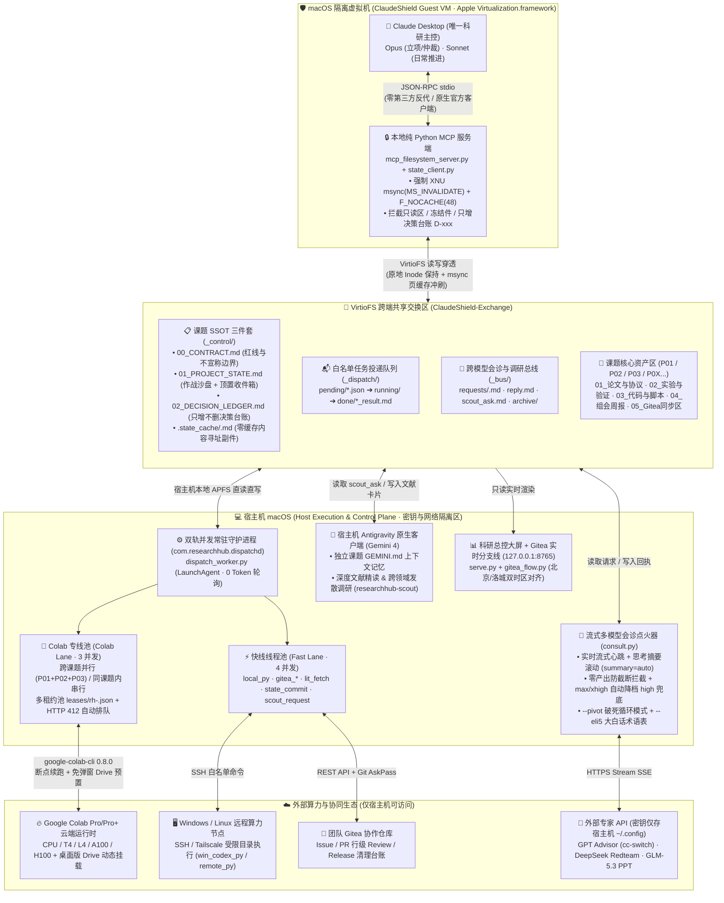
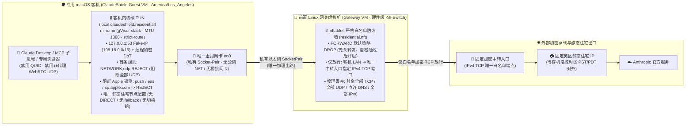
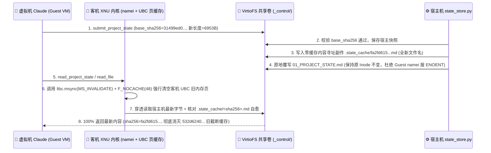
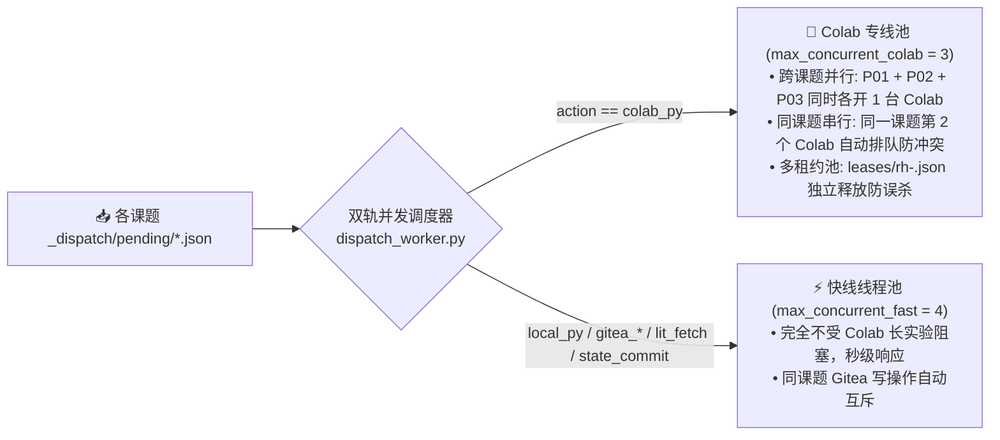

# ResearchHub 整体系统架构与 Claude 零封号安全隔离设计白皮书

> **核心原则**：**主控在客机（Claude Desktop VM 物理隔离） + 算力与密钥在宿主机（0 API 密钥暴漏） + 跨端纯文件总线通信（VirtioFS 零缓存失真 + 白名单任务队列）**。

---

## 一、 整体系统拓扑架构图（End-to-End Architecture）

---

## 二、 如何 100% 保证 Claude 账号安全与环境纯净？（六大安全铁律）

本架构在设计之初的核心目标就是：**既要让 Claude 作为唯一科研主控统领全局，又要 100% 杜绝封号风控、密钥泄漏、提示词注入与实验数据污染**。具体由以下 6 层物理与代码护栏实现：

### 1. 虚拟机物理隔离与双 VM 串行住宅网络架构（Dual-VM Socket-Pair & Fail-Closed Residential Egress）

为了彻底消除宿主机复杂分流环境（国内直连规则、IPv6 双栈、多节点切换、UDP/WebRTC/DNS 泄漏）对 Claude 账号的风控威胁，系统采用 **「macOS 专用客机 + Linux 防火墙网关机」双虚拟机串行物理拓扑**（由 `VMCoordinator.swift` 统一编排）：

#### 核心网络防封与零泄漏机制（6 层网络级护栏）：
1. **双 VM 物理网卡气隙隔离（No Direct NAT on macOS Guest）**：
   - `VMCoordinator.swift` 启动两台虚拟机：**受保护的 macOS 客机**与**前置 Linux 网关机**。
   - **macOS 客机没有任何公网 NAT、桥接（Bridged）或宿主机共享网卡**，仅有一张通过内存私有 `socketpair` 连接到 Linux 网关机的 `en0` 网卡。
   - **先网关、后客机（Fail-Closed Boot）**：宿主机必须先启动 Linux 网关机、完成 `nftables` 规则校验与离线 `namespace` 自检后，才允许启动 macOS 客机。
2. **客机内嵌唯一静态住宅节点 TUN（零 `DIRECT` / 零 `fallback`）**：
   - 客机内部通过系统级守护进程 `local.claudeshield.residential` 运行 `mihomo`（`gVisor` 网络栈、`MTU 1380`、`strict-route: true`、`auto-route: true`），统一接管 Claude Desktop、所有 MCP 子进程与浏览器的全机流量。
   - 客机配置中**仅保留唯一一个静态住宅出口节点**，彻底剔除 `DIRECT` 直连、多节点自动测速切换组与 `fallback` 回退组——即便上游网络波动，也只会断网等待，**绝不回退到直连 IP 或跳变到其他国家/机房节点**。
3. **合成 DNS（Fake-IP + 远程加密 DoT）防 DNS 污染与泄漏**：
   - 客机 `127.0.0.1:53` 配合 `dns-hijack: any:53` 接管全机 DNS，本地立即返回 `198.18.0.0/15` 合成 Fake-IP；所有 `nameserver`、`default-nameserver`、`proxy-server-nameserver` 均绑定加密 DoT 经唯一住宅节点远端解析，**零本地运营商 DNS 暴露**。
4. **全量 UDP / QUIC / WebRTC / IPv6 与 Apple 系统遥测硬阻断**：
   - **UDP 零放行**：规则首条强制 `NETWORK,udp,REJECT`，配合客机浏览器启动参数禁用 QUIC 与非代理 WebRTC UDP，彻底封死 STUN 打洞探测真实 IP。
   - **IPv6 全栈关闭**：客机核心、DNS 与网关层全面禁用 IPv6，消除宿主机物理网卡全局 IPv6 旁路风险。
   - **Apple 遥测阻断**：显式拦截 `push.apple.com`、`ess.apple.com`、`xp.apple.com`（`REJECT`），防止 macOS 系统后台推送服务外联。
   - **事务化网络自愈（`guest-network-common.sh` & `repair-guest-network.sh`）**：客机网络维护采用严格的文件锁、离线沙盒校验（`sandbox-exec` 禁网预检 `candidate.yaml`）、`198.18.x.x` 合成 DNS 探针核验与失败全量原子回滚。
5. **前置 Linux 网关 `nftables` 硬件级熔断开关（Hardware Kill-Switch）**：
   - 即使客机内部代理进程意外崩溃、或某个二进制程序试图绕过客机 TUN 直接发包，数据包一旦从 `en0` 进入前置 Linux 网关机，`nftables` (`FORWARD` 链默认 `DROP`) **仅放行发往唯一加密中转入口指定 IPv4 TCP 端口的密文流量**，其余任何直连 IP、全部 UDP、直连 DNS 与 IPv6 数据包均在网关层被物理丢弃（`DROP`）。
6. **单向受控剪贴板（`VZVirtioSocketDevice`）与跨时区指纹对齐**：
   - **受控纯文本剪贴板**：关闭主客机自动剪贴板同步，仅允许宿主机主动拨号传输 `<=256 KiB` 纯文本；客机文本取回宿主机前强制弹窗预览确认，防止恶意多行命令注入宿主机。
   - **出口环境与时区对齐**：客机保持与美区静态住宅 IP 一致的 `America/Los_Angeles (PST/PDT)` 时区与语言指纹；宿主机调度器与大屏在任务回执层自动执行 **北京时间（`UTC+8`）↔ 虚拟机洛城时间（`PST/PDT`）** 双时区对齐。

### 2. 严禁 OAuth 逆向反代（Official Client Only Policy）
- **Claude 与 Antigravity (Gemini) 均只使用官方原生客户端**：
  - 严禁将 Claude Desktop 或 Antigravity 的 OAuth 登录凭证挂载到 `cli2api`、第三方反代网关或非官方自动化脚本中。
  - 跨模型协同完全通过**共享文件夹中的 Markdown / JSON 结构化文件**完成交接（`_bus/` 与 `_dispatch/`），从根源上规避账号风控。

### 3. 零 Node/npx 依赖的纯标准库只读防护 MCP（`mcp_filesystem_server.py`）
- 虚拟机内不使用外部下载的 npm 包，而是运行中枢自带的 **单文件纯 Python 标准库 MCP 服务端**（`00_全局中枢_Hub/scripts/mcp_filesystem_server.py`），在代码层硬编码了 4 道安全门禁：
  1. **目录越权拦截（`PathGuard`）**：仅允许访问挂载的 `/Volumes/My Shared Files/ClaudeShield-Exchange` 交换卷，任何符号链接逃逸或越界访问直接拒绝。
  2. **核心中枢与历史归档只读保护**：硬编码拦截虚拟机对 `00_全局中枢_Hub/`、`99_历史归档_Archive/`、`benchmark/`、`冻结件/` 及 `冻结存档-*` 的任何写入、修改、重命名或删除操作。
  3. **决策台账只增不删门禁（`ensure_append_only_ledger`）**：当 Claude 修改 `_control/02_DECISION_LEDGER.md` 时，MCP 自动提取原有的全部决策编号（`D-001`、`D-002`...）；若发现任何历史编号丢失，当场拒绝写入，防止上下文遗忘导致推翻既有拍板结论。
  4. **状态文件事务化提交（`read_project_state` / `submit_project_state`）**：强制携带 `base_sha256` 乐观锁校验，宿主机自动在 `~/.local/state/researchhub/project-state/` 保存前后快照，随时可一键无损回滚。

### 4. 宿主机密钥与凭证单向隔离（Zero-Credential Exposure to VM）
- 所有外部 API 密钥（`OPENAI_API_KEY`、`DEEPSEEK_API_KEY`、`GLM_API_KEY`、`GITEA_TOKEN`）以及 Google Colab OAuth 钥匙串 **100% 存储在宿主机私有目录 `~/.config/research_hub/.env`（权限 `0600`）与宿主机钥匙串中**。
- 虚拟机无法读取宿主机 `$HOME` 目录；即使共享区中的协作文档包含恶意 Prompt Injection，虚拟机内的 Claude 也拿不到任何外部密钥或宿主机 Shell 权限。

### 5. 白名单任务总线（`_dispatch/` 禁绝任意 Shell 执行）
- 虚拟机内的 Claude 需要跑实验、拉取 Gitea 或调用 Colab 时，只能向 `_dispatch/pending/<job_id>.json` 投递结构化工单。
- 宿主机 `dispatch_worker.py` **严禁执行任意 Shell 字符串**，仅接受白名单动作（`colab_py`、`local_py`、`win_codex_py`、`remote_py`、`gitea_pull`、`gitea_push_pr`、`lit_fetch`、`state_commit`、`scout_request`），并对脚本路径（必须位于 `03_代码与脚本/` 或 `02_实验与验证/`）、参数字符集与大文件（禁止向 Gitea 提交 `>10MB` 或 `.npz/.zip/.pdb`）进行严格校验。

### 6. Git 提交前隐私与绝对路径零泄漏门禁（`privacy_guard.py`）
- 仓库内置 `00_全局中枢_Hub/scripts/privacy_guard.py` 并挂载为 `.git/hooks/pre-commit` 钩子：一旦代码或文档中出现个人主目录绝对路径、API Token、内网 IP 或隐私邮箱，自动拦截 Git 提交，确保推送到 GitHub 的代码 100% 脱敏。

---

## 三、 本轮核心工程故障修复与架构升级记录（2026-11-26）

### 修复 1：macOS 虚拟机 VirtioFS 双层缓存不一致（`532d6240…` 截断哈希与 `FileNotFoundError` 根治）

- **根因复现**：
  1. **为什么不能在宿主机对已有共享文件做 `os.replace`**：macOS 客机 XNU 内核的 `namei` 目录项缓存会一直指向旧 Inode；宿主机 `os.replace` 删掉旧 Inode 后，客机打开文件会直接报错 `FileNotFoundError (ENOENT)`。
  2. **为什么单纯原地覆写同一 Inode 会读出 `532d6240…`**：当宿主机原地把 `01_PROJECT_STATE.md`（Inode `17301234`）从 `7,754` 字节改写为 `6,953` 字节（新哈希 `fa2fd615…`）时，客机 XNU 内核因 Inode 未变而沿用了内存中已缓存的旧 UBC 页面（`31499ed0…`），仅调用 `ubc_setsize(vp, 6953)` 将旧内容截断到前 `6,953` 字节（`SHA256(old_bytes[:6953]) == 532d6240c51db5b8...`）。
- **根治方案（`state_store.py` + `state_client.py` + `mcp_filesystem_server.py` + `fix_vm_cache.sh`）**：
  - **宿主机端**：严禁对 `01_PROJECT_STATE.md` 和 `_bus/reply.md` 使用 `os.replace` 换 Inode，始终原地覆写原 Inode（彻底消灭 `FileNotFoundError`）；同时每次提交在 `_control/.state_cache/<sha256>.md` 生成全新文件名快照（客机零历史缓存）。
  - **客机端**：在 `state_client.py` 与 `mcp_filesystem_server.py` 读取前调用 XNU 内核级 **`libc.msync(addr, size, MS_INVALIDATE)` (`0x0002`) + `fcntl(fd, F_NOCACHE, 1)` (`48`)** 强行驱逐客机 RAM 中的旧 UBC 页缓存，并自动比对 `.state_cache/<sha256>.md` 通过客机自身 VFS 通道完成自愈刷新。

---

### 修复 2：Colab 3 路跨课题并行 + 快慢双轨调度解耦 + 动态 Drive 自动挂载

- **多租约池隔离（`colab_jobs.py`）**：将单一 `lease.json` 升级为 `~/.local/state/researchhub/colab/leases/rh-<uuid>.json` 租约池；任务结束仅释放自身 `endpoint`，`recover()` 自动跳过在途活跃会话，100% 杜绝多开时互相误杀；遇到 Google 账号并发上限（`CAPACITY / HTTP 412`）自动每 45 秒退避排队。
- **云端脚本落盘自校验修复（`colab_jobs.py` & `colab_checkpoint.py`）**：在云端执行 wrapper 前先将 `_rh_script_bytes` 落盘到 `/content/<script.name>`，解决了实验脚本计算自身代码 `sha256(__file__)` 时报 `FileNotFoundError` 的问题。
- **未来新课题 Drive 动态自动挂载（`resolve_drive_project_root`）**：配置 `drive_root` 后，不仅支持 `P01`/`P02`/`P03`，未来新增任何 `P04_xxx` 课题时均自动在 `我的云端硬盘/ResearchHub_Colab/<新课题名>` 下创建并绑定同步目录，无需手动改配置。

---

### 修复 3：GPT `advisor` 最高档 600 秒网关断流防护与实时思考滚动（`consult.py`）
- **根因**：`gpt-6.2-astra` 在 `max` (`ultra`) 档位下内部推理长达 600～830 秒，撞上 `token.bigfish.space` 中转网关的 600 秒 Nginx 超时墙，导致流被静默掐断、写入 0 字正文。
- **修复**：
  1. 默认档位切回黄金稳定档 `high`（约 70～120 秒完成），保留 `--effort xhigh|max` 按需冲高能力；
  2. 请求体开启 `"reasoning": {"effort": ..., "summary": "auto"}` 并加入终端实时推理心跳与思考摘要小标题滚动；
  3. 加入**零产出防截断拦截器**：若流结束但正文为 0 字，绝不伪报成功或写入空回复；若处于 `max/xhigh/ultra` 则自动告警并就地降级到 `high` 重试，确保 Claude 端 100% 拿到完整会诊回执。
