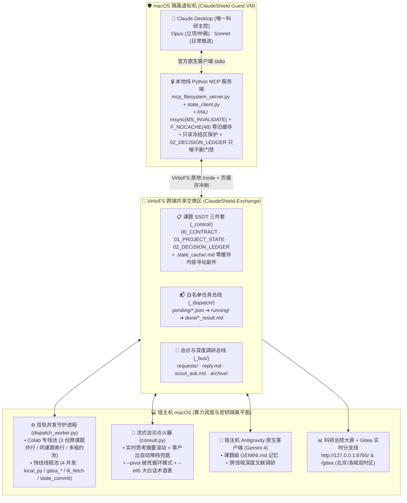

# ResearchHub · 多 AI 协同科研总控中枢

> 一个面向个人/课题组的生产级多 AI 协同科研工作流框架：**虚拟机隔离主控（Claude Desktop 零封号架构） + 宿主机双轨并发算力总线（3 路 Colab 并行 + 本地/远程快线） + 只读红队/科学顾问流式会诊 + VirtioFS 零缓存失真同步 + 科研总控大屏（含 Gitea 实时分支线）**。零第三方 Python 重依赖，兼容 macOS/Linux 原生 Python 3.9+。

📄 **完整架构与安全白皮书**：请参阅 [ARCHITECTURE_AND_SECURITY.md](ARCHITECTURE_AND_SECURITY.md)

---

## 一、 整体系统架构图



---

## 二、 核心特性

1. **Claude 零封号物理隔离与双 VM 住宅网络架构（详见 [ARCHITECTURE_AND_SECURITY.md](ARCHITECTURE_AND_SECURITY.md)）**
   - **双虚拟机串行网卡气隙隔离（`macOS Guest VM` + `Linux Gateway VM`）**：macOS 客机不配置任何公网 NAT 或桥接网卡，仅通过私有 `socketpair` (`en0`) 连接前置 Linux 网关机；网关机 `nftables` 默认 `DROP` 一切转发，仅白名单放行唯一加密中转入口的 IPv4 TCP 端口，构成硬件级断网熔断开关（Fail-Closed Kill Switch）。
   - **唯一静态住宅出口 + 零泄漏封锁**：客机内置 `mihomo` (`gVisor` TUN + `strict-route`)，仅配置单一固定美区住宅节点（无 `DIRECT`、无 `fallback`、无自动切换组）；开启 `127.0.0.1:53` Fake-IP + 远端加密 DoT，首条规则 `NETWORK,udp,REJECT` 阻断全部 UDP/QUIC/WebRTC，全栈关闭 IPv6 并拦截 Apple 系统遥测域名（`push/ess/xp.apple.com`），客机保持 `America/Los_Angeles` 时区与住宅 IP 完美对齐。
   - **官方原生客户端与零密钥暴露**：严禁任何 OAuth 逆向反代；所有外部 API 密钥（OpenAI / DeepSeek / GLM / Gitea / Colab）100% 物理隔离在宿主机 `~/.config/research_hub/.env` 与宿主机钥匙串中，虚拟机零密钥暴露。
   - **VirtioFS 双层缓存一致性（`state_store.py` + `state_client.py` + `fix_vm_cache.sh`）**：宿主机采用「原地 Inode 覆写 + `.state_cache/<sha256>.md` 零缓存内容寻址副件」杜绝客机 `namei` 目录缓存报 `FileNotFoundError`；客机读取层调用 XNU 内核级 `libc.msync(MS_INVALIDATE)` (`0x0002`) + `F_NOCACHE` (`48`) 强行驱逐旧 UBC 内存页缓存，彻底根治跨端哈希不一致。
2. **双轨并发算力总线与 3 路 Colab 多开租约池（`dispatch_worker.py` + `colab_jobs.py`）**
   - **Colab 专线池（默认 `3` 并发）**：支持 `P01`/`P02`/`P03` 跨课题同时开 3 台 Colab（CPU / T4 / L4 / A100 / H100 / G4）并行跑实验；同一课题内部自动串行排队以保护 Checkpoint 与输出文件；采用 `leases/rh-<uuid>.json` 多租约池精准释放，遇 Google `HTTP 412` 并发上限自动退避排队。
   - **快线通道（默认 `4` 并发）**：`local_py`、`gitea_*`、`lit_fetch`、`win_codex_py`、`state_commit`、`scout_request` 独立并发，永不被 Colab 长实验阻塞。
   - **动态 Google Drive 自动绑定**：通过 `drive_root` 自动为现有及未来新增课题（`P04_...`）创建并挂载专属桌面版 Drive 同步目录，且自动注入 `google.colab.drive.mount` 免交互补丁。
3. **跨模型流式会诊与破死循环机制（`consult.py` + `models.toml`）**
   - 支持 `redteam`（DeepSeek）、`advisor`（GPT / `cc-switch`）、`all`（双盲并发）、`glm_heavy` / `glm_fast`。
   - 内置 **实时思考摘要流式滚动（`summary="auto"`）+ 服务端流式心跳**、**600s 网关断流零产出拦截 + `max/xhigh -> high` 自动降档重试**、**`--pivot` 破除局部修补死循环（强制输出 Kill / Simplify / Pivot 三选一拍板卡）** 与 **`--eli5` 大白话术语对照表**。
4. **科研总控大屏与独立 Gitea 实时协作分支线（`dashboard/serve.py` + `scripts/gitea_flow.py`）**
   - 主大屏 `http://127.0.0.1:8765/` 与独立 Gitea 实时分支线入口 `http://127.0.0.1:8765/gitea`（支持地铁图式主线/分支拓扑、PR 行级审查意见、Issue 状态与 Release 14 天清理台账追踪，全链路支持北京时间 `UTC+8` 与虚拟机洛杉矶时间 `PST/PDT` 双时区对照）。
5. **工程与学术防错护栏（`scripts/`）**
   - `job_status.py`：进程退出码（`status`）与科学放行门禁（`verdict: PASS/HOLD/FAIL`）解耦 + 5 阶段实验生命周期门禁。
   - `context_distiller.py`：`01_PROJECT_STATE.md` 与 `02_DECISION_LEDGER.md` 历史上下文无损蒸馏归档（压缩率 77%～86%）。
   - `privacy_guard.py`：Git `pre-commit` 隐私路径与密钥零泄漏拦截器。

---

## 三、 目录结构

```text
research-hub/
├── ARCHITECTURE_AND_SECURITY.md # 整体系统架构图、虚拟机安全隔离与故障修复白皮书
├── README.md                    # 项目总览与快速开始
├── 00_全局中枢_Hub/
│   ├── _project_template/       # 新课题标准模板（CLAUDE.md / GEMINI.md / _control / _bus / 01~04）
│   ├── dashboard/               # 科研总控大屏与独立 /gitea 实时分支线 (serve.py + index.html)
│   ├── plotting/                # 顶刊绘图统一风格模板 (Okabe-Ito 色盲友好)
│   ├── scripts/                 # 核心守护进程与工具链 (dispatch_worker / colab_jobs / state_store / fix_vm_cache 等)
│   ├── skills/                  # 18 个按需懒加载科研 Skill 专区
│   ├── consult.py               # 多模型流式会诊 CLI (含 --pivot / --eli5 / 自动降档兜底)
│   ├── models.toml              # 模型路由与系统提示词热插拔配置
│   ├── new_project.py           # 一键建舱脚本 (newproj)
│   ├── policy.toml              # 只读归档与只增台账保护策略
│   └── OPERATION_MANUAL.md      # 详细跨端协作操作手册
├── .env.example                 # API Key 环境变量模板
├── install.sh                   # 一键初始化目录与 shell 别名
└── LICENSE
```

---

## 四、 快速开始

```bash
git clone https://github.com/greatLiverheat605/research-hub.git
cd research-hub
chmod +x install.sh
./install.sh
```

1. 部署宿主机常驻双轨调度服务与总控大屏：
   ```bash
   python3 00_全局中枢_Hub/scripts/install_services.py
   ```
2. 在 macOS 虚拟机内一键同步无缓存 MCP 与冲刷 VirtioFS 内存页缓存：
   ```bash
   sh "/Volumes/My Shared Files/ClaudeShield-Exchange/00_全局中枢_Hub/scripts/fix_vm_cache.sh"
   ```
3. 打开总控大屏与 Gitea 实时分支线：
   - 总控大屏：`http://127.0.0.1:8765/`
   - Gitea 实时协作分支线：`http://127.0.0.1:8765/gitea`
